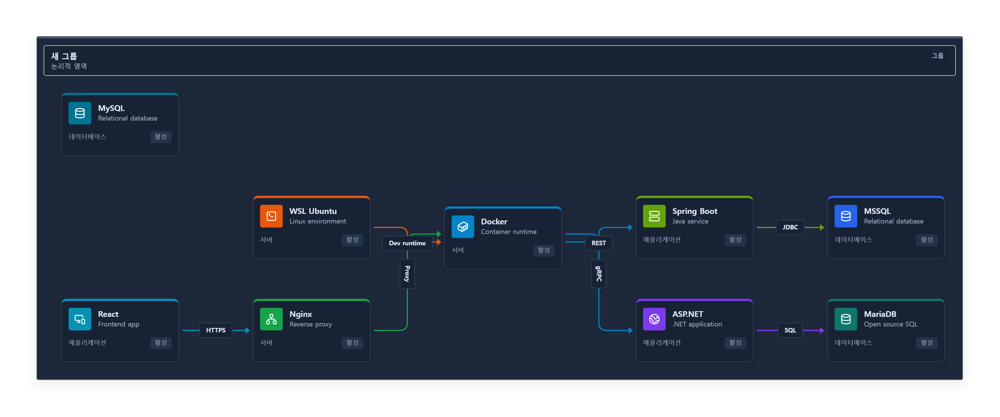
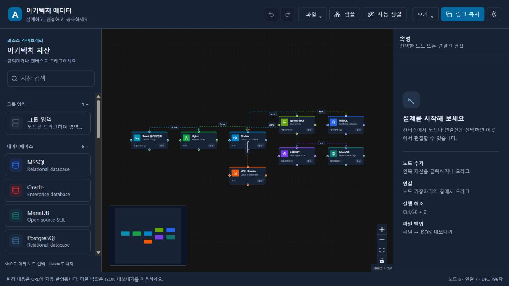
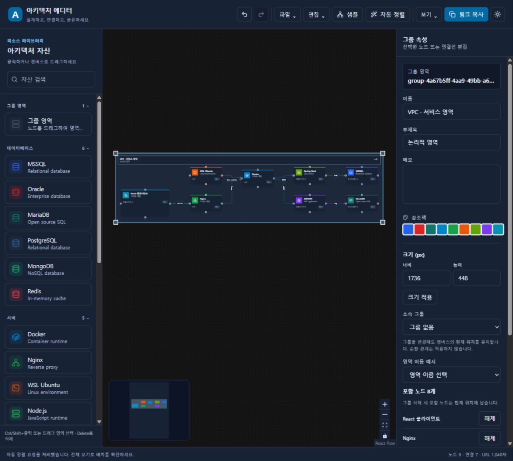

# Serverless Architecture Diagram Editor

URL 하나로 공유할 수 있는 서버리스 아키텍처 다이어그램 편집기입니다.  
별도의 백엔드, 데이터베이스, 로그인, 파일 저장 서버 없이 브라우저 안에서만 동작하며, 다이어그램의 전체 상태를 압축해서 URL hash에 저장합니다.

이 README는 코드를 직접 분석하지 않아도 프로젝트의 목적, 기술 스택, 주요 기능, 상태 저장 방식, 파일 구조, 실행 방법을 이해할 수 있도록 작성되었습니다.

## 1. 프로젝트 목적

이 프로젝트는 시스템/서버리스/인프라 아키텍처를 빠르게 그려 보고, 결과물을 URL 또는 파일로 공유하기 위한 웹 기반 다이어그램 에디터입니다.

일반적인 다이어그램 도구는 서버 저장소, 계정, 프로젝트 파일이 필요하지만, 이 앱은 다음 흐름을 목표로 합니다.

1. 브라우저에서 아키텍처 노드를 배치한다.
2. 노드와 엣지를 연결한다.
3. 노드/연결 정보를 수정한다.
4. 앱이 현재 상태를 압축해 URL hash에 자동 저장한다.
5. URL을 복사하면 같은 다이어그램을 그대로 복원할 수 있다.

즉, 이 앱의 핵심 아이디어는 **"다이어그램 파일 자체를 URL 안에 넣는다"** 입니다.

## 2. 핵심 특징

- 백엔드가 없는 완전한 프론트엔드 앱
- 다이어그램 상태를 URL hash에 압축 저장
- React Flow 기반 노드/엣지 편집
- 드래그 앤 드롭으로 32개 아키텍처 자산과 그룹 추가
- 즐겨찾기와 최근 사용 자산 목록
- 노드/연결선 Inspector 편집
- Undo / Redo 지원
- 자동 레이아웃 정렬
- JSON import/export 지원
- PNG/SVG/PDF 출력과 현재 화면/전체 영역 선택
- 샘플 아키텍처 즉시 로딩
- URL 복원 실패 시 오류 사유 안내 및 현재 작업 보존
- 한국어 기본 UI와 라이트/다크 테마
- 자산 클릭 추가, 카테고리 접기/펼치기
- 좁은 화면의 자산/속성 패널 전환과 파일/보기 메뉴
- 다중 선택·일괄 속성 편집·정렬 및 간격 조절
- 내부 클립보드 복사/붙여넣기와 그룹·내부 연결 복제
- 일반/그룹 노드 크기, 연결선 선 종류·경로·색·화살표 편집

## 3. 기술 스택

### Core

- React 18+
- TypeScript
- Vite

### UI / Styling

- Tailwind CSS
- lucide-react 아이콘

### Diagram Engine

- `@xyflow/react`
  - React Flow의 최신 패키지 계열입니다.
  - 노드, 엣지, 미니맵, 컨트롤, 드래그 앤 드롭, 선택 이벤트를 처리합니다.

### State Management

- Zustand
  - nodes, edges, 선택 상태, 히스토리, 편집 액션을 관리합니다.

### URL Compression

- pako
  - JSON 상태를 DEFLATE 압축합니다.
- base-64
  - 압축된 binary 데이터를 Base64 문자열로 변환합니다.

### Export

- html-to-image
  - React Flow 캔버스를 PNG 이미지로 변환합니다.

## 4. 주요 기능 상세

### 4.1 URL 기반 저장/복원

앱은 서버나 localStorage가 아니라 `window.location.hash`에 현재 다이어그램 상태를 저장합니다.

저장 흐름:

```text
Graph State
-> minified JSON
-> JSON.stringify
-> pako.deflate
-> Base64 encode
-> URL-safe 문자 치환
-> window.location.hash
```

복원 흐름:

```text
window.location.hash
-> URL-safe 문자 복원
-> Base64 decode
-> pako.Inflate (스트리밍 해제, 최대 5 MiB)
-> JSON.parse
-> React Flow nodes / edges 복원
```

URL-safe 치환 규칙:

```text
+ -> -
/ -> _
= -> ~
```

이 방식 덕분에 URL만 복사해도 다이어그램 전체 상태를 공유할 수 있습니다.

### 4.2 Minified Data Structure

URL 길이를 줄이기 위해 저장용 구조는 짧은 키를 사용합니다.

노드 저장 구조:

```ts
interface MinifiedNode {
  i: string; // node id
  t: string; // node type
  p: [number, number]; // position [x, y]
  d: ArchitectureNodeData; // node data
}
```

엣지 저장 구조:

```ts
interface MinifiedEdge {
  i: string; // edge id
  s: string; // source node id
  t: string; // target node id
  l?: string; // edge label
}
```

전체 저장 구조:

```ts
interface MinifiedGraph {
  n: MinifiedNode[];
  e: MinifiedEdge[];
}
```

구현 위치:

- `src/utils/urlUtils.ts`

### 4.3 Debounced URL Sync

상태가 바뀔 때마다 URL을 즉시 업데이트하면 브라우저 history가 과도하게 쌓이고 성능도 나빠질 수 있습니다.

그래서 이 앱은 Zustand store 변경을 구독하고, 약 400ms debounce 후 `window.history.replaceState`를 사용해 URL을 갱신합니다.

특징:

- `pushState`가 아니라 `replaceState` 사용
- 브라우저 뒤로가기 히스토리를 불필요하게 늘리지 않음
- 노드 이동/편집/삭제/연결 등 상태 변경이 URL에 자동 반영됨

구현 위치:

- `src/App.tsx`

### 4.4 아키텍처 자산 Sidebar

왼쪽 Sidebar에는 드래그해서 캔버스에 추가할 수 있는 아키텍처 자산이 있습니다.

현재 제공되는 자산:

#### Database

- MSSQL
- Oracle
- MariaDB
- PostgreSQL
- MongoDB
- Redis

#### Server

- Docker
- Nginx
- WSL Ubuntu
- Node.js
- Python

#### Application

- Spring Boot
- ASP.NET
- React

#### Cloud

- AWS
- Azure
- Google Cloud

#### Network

- Load Balancer
- Firewall
- Message Queue

Sidebar 기능:

- 자산 검색/필터
- 카테고리별 그룹 표시
- HTML5 drag and drop으로 React Flow 캔버스에 노드 생성
- 클릭 또는 키보드 Enter로 현재 캔버스 중앙에 노드 추가
- 한국어 분류 검색, 분류별 접기/펼치기, 아이콘 미리보기와 설명 툴팁

구현 위치:

- `src/components/Sidebar.tsx`
- `src/data/assets.ts`

### 4.5 React Flow Canvas

중앙 캔버스는 React Flow 기반입니다.

지원 기능:

- 노드 드래그
- 노드 연결
- 엣지 선택
- 노드 선택
- 배경 점 grid
- MiniMap
- Zoom / Fit View / Interactivity controls
- Delete / Backspace 삭제

구현 위치:

- `src/components/ArchitectureCanvas.tsx`

### 4.6 Custom Architecture Node

모든 아키텍처 자산은 커스텀 노드 컴포넌트로 렌더링됩니다.

노드에 표시되는 정보:

- 아이콘
- label
- subtitle
- category
- active 상태 badge
- note 일부 표시
- accent color

노드 연결 handle:

- 상/우/하/좌 네 면에 연결 handle 제공
- React Flow `ConnectionMode.Loose`로 각 면에서 연결 가능

구현 위치:

- `src/components/CustomNodes/ArchitectureNodeCard.tsx`

### 4.7 Inspector

오른쪽 Inspector는 선택한 대상에 따라 다르게 동작합니다.

#### 노드 선택 시

수정 가능 항목:

- Label
- Subtitle
- Note
- Accent color
- 노드/그룹 너비·높이와 소속 그룹 (현재 위치 유지)
- 그룹의 영역 이름 예시와 포함 노드 해제

지원 액션:

- Duplicate
- Delete

Duplicate는 선택한 노드를 약간 오른쪽 아래로 복제하고 새 노드를 선택합니다.

Delete는 해당 노드를 삭제하며, 연결된 엣지도 함께 제거합니다.

#### 엣지 선택 시

수정 가능 항목:

- Edge label
- 방향(정방향/역방향/양방향), 라벨 표시 모드와 회전 방향
- 연결 면 자동/수동 선택, 라벨 X/Y 위치
- 실선/파선/점선, SmoothStep/Step/Straight
- 연결선 색상 picker 또는 #RRGGBB 입력, 노드 색상 따르기
- 채운/열린/없는 화살표 (연결 방향 설정은 유지)

지원 액션:

- Delete edge

구현 위치:

- `src/components/Inspector.tsx`

### 4.8 Undo / Redo

Zustand store에 자체 history stack을 구현했습니다.

지원 단축키:

- `Ctrl + Z`: Undo
- `Ctrl + Y`: Redo
- `Ctrl + Shift + Z`: Redo
- `Ctrl/⌘ + A`: 전체 선택
- `Ctrl/⌘ + C / V`: 선택 복사 / 붙여넣기
- `Ctrl/⌘ + D`: 선택 복제
- `Delete / Backspace`: 선택 삭제

입력칸에서는 브라우저의 텍스트 편집 동작을 유지합니다. 복사/붙여넣기는 같은 페이지의 내부 클립보드를 사용합니다. OS clipboard나 다른 탭으로의 다이어그램 복사는 지원하지 않습니다. 그룹을 복사하면 내부 노드와 내부 연결선도 새 ID로 복제합니다.

히스토리에 기록되는 작업:

- 노드 추가
- 노드 이동 완료
- 노드 데이터 수정
- 노드 복제
- 노드 삭제
- 엣지 연결
- 엣지 삭제
- 엣지 라벨 수정
- 자동 레이아웃
- 그래프 교체

히스토리에 기록하지 않는 작업:

- 단순 선택 변경
- React Flow 내부 dimensions 측정 변경
- 드래그 중간 상태

히스토리 최대 크기:

- 80 steps

구현 위치:

- `src/store/useGraphStore.ts`

### 4.9 Sample Diagram

`샘플` 버튼을 누르면 기본 샘플 아키텍처가 로드됩니다. 900px 이하에서는 `배치` 메뉴에 있습니다.

샘플 구성:

- React
- Nginx
- Docker
- Spring Boot
- ASP.NET
- MSSQL
- MariaDB
- WSL Ubuntu

샘플 엣지 라벨:

- HTTPS
- Proxy
- REST
- gRPC
- JDBC
- SQL
- Dev runtime

구현 위치:

- `src/data/sampleGraph.ts`

### 4.10 Auto Layout

`정렬 설정`에서 왼쪽→오른쪽(LR), 위→아래(TB), 오른쪽→왼쪽(RL), 아래→위(BT)와 계층/노드 간격(20–500px)을 선택하고 `설정으로 정렬`을 누르세요. `자동 정렬`은 현재 설정을 재사용합니다. 기본값은 LR, 계층 130px, 노드 70px입니다.

ELK layered로 중첩 그룹 내부부터 배치하고 자식의 실제 크기에 맞춰 그룹을 조절합니다. 제목 여백 88px, 나머지 여백 32px을 확보합니다. 그룹 사이 연결은 해당 계층의 그룹 간 관계로 반영하며 순환·비연결 그래프도 처리합니다. 엔진 오류 시 방향과 실제 크기를 반영한 겹침 없는 일렬 배치로 전환하고 안내합니다.

수동 연결 면/선 스타일은 유지하며 자동 연결 면은 절대 좌표로 다시 계산합니다. 엣지 교차를 줄이는 ELK 순서를 사용하지만 모든 연결선의 노드 우회나 교차 제거를 보장하지 않습니다. 정렬 중 다른 편집/Undo가 발생하면 결과를 폐기합니다. 전체 정렬과 그룹 크기 변경은 Undo 한 단계입니다.

구현: `src/utils/layoutGraph.ts`, `src/store/useGraphStore.ts`.

### 4.11 JSON Import / Export

#### JSON Export

`파일 → JSON 내보내기`에서 현재 그래프 상태를 `.json` 파일로 다운로드합니다.

파일명 형식:

```text
architecture-diagram-YYYY-MM-DD.json
```

내보내는 데이터:

- version: 1
- nodes
- edges
- position
- node data
- edge label
- 사용자가 지정한 연결선 스타일과 연결 면 (선택/측정/생성 경로는 제외)

#### JSON Import

`파일 → JSON 가져오기`에서 `.json` 파일을 선택하면 다이어그램을 복원합니다.

Import 시 검증:

- nodes 배열 존재 여부
- edges 배열 존재 여부
- node id / position / data 필드 유효성
- edge source / target이 실제 node id를 참조하는지 확인
- 중복/빈 ID, 비정상 좌표, 존재하지 않는 부모와 부모 순환 거부
- 일부 항목이 잘못되어도 전체 Import를 거부하여 조용한 데이터 누락 방지

잘못된 JSON이면 필드 경로/참조/용량/버전 오류를 안내하고 현재 작업을 유지합니다. 현재 노드가 있으면 샘플/새 문서/가져오기/외부 공유 URL 적용 전에 교체 확인창을 표시하며 취소할 수 있습니다. 파일을 읽는 동안 편집한 경우 가져오기를 중단합니다. 적용 직후 URL에 반영하고 이전 문서는 Undo로 복원합니다.

#### 버전과 입력 제한

신규 JSON은 `{version:1,nodes,edges}`, URL 압축 데이터는 `{v:1,n,e}`입니다. 버전이 없는 기존 형식과 최상위 edge.label은 그대로 읽습니다. 미지원 버전은 거부합니다. DEFLATE/Base64와 URL 치환 규칙은 유지합니다.

- 노드 최대 1,000개, 연결 최대 5,000개, 문자열 필드 최대 10,000자, 부모 깊이 최대 32단계.
- JSON 파일/압축 해제 후 UTF-8 최대 5 MiB, 압축 URL 입력 최대 1 MiB. 16 KiB 단위 해제 중 상한을 검사합니다.
- 전체 URL 8,000자 초과 시 JSON 백업 권고, 64,000자 초과 시 자동 URL 저장/링크 복사를 중단하고 마지막 저장 주소와 현재 그래프를 보존합니다. JSON 내보내기는 계속 가능합니다. 입력 한도를 넘긴 백업은 분할/축소 후 가져와야 합니다.
- ID/참조/부모 순환, kind/category/enum/hex, 유한 좌표·크기·라벨 오프셋을 검증합니다. 기존 양수 치수는 UI 상한만으로 거부하지 않습니다.
- URL 저장은 편집 완료 후 400ms debounce입니다. 선택/측정만 바뀌거나 드래그/resize 중이면 압축하지 않습니다. 미저장 변경이 있으면 페이지 이탈 시 브라우저 경고를 요청합니다. 브라우저 정책에 따라 경고가 생략될 수 있습니다.
- 외부 hashchange는 먼저 검증하고 현재 그래프가 있으면 확인 후 적용합니다. 손상된 링크나 취소는 현재 주소/작업을 보존합니다. hash에는 서버 백업이나 별도 문서 목록이 없습니다.

구현 위치:

- `src/utils/jsonUtils.ts`
- `src/App.tsx`

### 4.12 PNG / SVG / PDF 출력

`파일 → PNG / SVG / PDF 내보내기`에서 설정하고 `파일 만들기`를 누른 후 미리보기를 확인하고 `파일 다운로드`로 저장하세요.

- 범위: 전체 다이어그램 또는 현재 화면. 전체 영역은 화면 밖 노드·그룹·연결선·이동/회전한 라벨과 64px 여백을 포함합니다. 현재 화면은 화면 밖 요소가 잘릴 수 있습니다.
- PNG: 1×/2×/3×/4× 배율, 현재 테마/흰색/어두운색/투명 배경. 기본은 전체 영역·2×·현재 테마입니다.
- SVG: 브라우저에서 확대할 수 있는 이미지이며 배율은 1×입니다. 노드 HTML을 foreignObject로 포함하므로 일부 문서 편집기/변환기에서 지원하지 않을 수 있습니다.
- PDF: 단일 페이지 이미지 PDF입니다. 한글·아이콘 모양은 이미지로 보존하며 텍스트 선택/검색과 페이지 분할은 지원하지 않습니다. 투명 배경은 흰색으로 바뀝니다.
- 한도: 한 변 8,192px 및 16,777,216픽셀. 초과하면 생성 전에 안내하므로 배율을 낮추거나 현재 화면을 선택하세요. 브라우저별 메모리 한도 때문에 그 이하에서도 실패할 수 있습니다.
- 원본 캔버스·선택·Undo/Redo·URL은 변경하지 않고 복제본에서 출력합니다. 미니맵·조작 도구·격자·연결 핸들·선택/resize 표시를 제외합니다. 노드 안의 생략된 메모/제목은 편집 화면 표시를 따르며 출력이 숨겨진 내용을 복원하지는 않습니다.
- 출력 연결선 라벨은 최대 320px 폭으로 줄바꿈하여 말줄임을 피합니다. 전체 영역은 확장된 라벨 크기로 다시 계산합니다. 설정을 바꾸면 이전 다운로드 링크를 해제하므로 다시 파일을 만드세요.
- PNG/SVG 미리보기의 체크무늬는 투명도를 표시하는 UI이며 파일에는 들어가지 않습니다. 파일명은 `architecture-all-YYYY-MM-DD.png` 같은 형식입니다.

내장 Chromium에서 PNG/SVG/PDF 파일 저장을 확인했습니다. PDF는 별도로 파싱하고 PNG 렌더링으로 내용을 확인했습니다. 다른 브라우저와 문서 편집기의 SVG 호환성은 별도 검증 대상입니다.

구현: `src/components/ExportDialog.tsx`, `src/utils/exportDiagram.ts`, `src/utils/imagePdf.ts`.



### 4.13 자산 라이브러리

기존 자산 20개와 그룹을 유지하고 MySQL, SQLite, Kubernetes, Linux, API Gateway, Apache Kafka, FastAPI, Next.js, AWS EC2/S3/Lambda, Azure Storage를 추가했습니다. 제품별 공식 로고 대신 Lucide의 일반 아이콘을 사용합니다. 출처와 라이선스는 [아이콘 고지](docs/ASSET_LICENSES.md)에 있습니다.

자산 옆 별 버튼으로 즐겨찾기를 켜고 `전체 / 즐겨찾기 / 최근 사용`으로 목록을 바꾸세요. 검색은 선택한 목록에 적용됩니다. 최근 사용은 클릭/드래그로 실제 추가한 종류 최대 8개를 최신순으로 표시합니다. 추가를 Undo해도 최근 사용 기록은 남습니다.

즐겨찾기/최근 사용은 이 브라우저의 `architecture-editor-assets-v1` 설정에 종류만 저장하며 다이어그램 내용이나 URL/JSON/히스토리에 포함되지 않습니다. 브라우저 저장이 차단되면 페이지 메모리에서 계속 사용할 수 있지만 새로고침 후 유지는 보장하지 않습니다. 탭 간 실시간 동기화는 제공하지 않습니다.

새 자산도 기존 v1 URL/JSON으로 저장하고 복원합니다. 이전 다이어그램은 그대로 열리지만 **새 자산이 들어 있는 다이어그램은 Phase 5 이상 앱이 필요**합니다.

## 5. 화면 구성

앱은 3영역 레이아웃입니다.

```text
+--------------------+--------------------------------+----------------------+
| Sidebar            | Canvas                         | Inspector            |
|                    |                                |                      |
| Architecture Assets| React Flow diagram editor      | Selected item editor |
| Search             | Nodes / Edges / MiniMap        | Node or Edge form    |
+--------------------+--------------------------------+----------------------+
```

상단 Toolbar에는 실행 취소/다시 실행, 샘플/자동 정렬, 링크 복사, 테마 전환이 있습니다. `파일` 메뉴에서 새 다이어그램·JSON 입출력·이미지/PDF 출력·캔버스 비우기를, `보기` 메뉴에서 전체 보기·확대/축소·격자·연결선 라벨 표시를 조절합니다. `편집` 메뉴에는 전체 선택·복사·붙여넣기·복제·그룹 생성·선택 삭제가 있습니다. 새 다이어그램과 캔버스 비우기는 그래프를 비우며 이전 작업은 실행 취소로 복원할 수 있습니다.

900px 이하에서는 자산/속성 패널 버튼으로 한 패널씩 열고, 샘플/자동 정렬은 `배치` 메뉴에서 실행합니다. 패널 닫기 버튼이나 Escape로 닫을 수 있습니다. 자산을 클릭하여 추가하면 패널이 닫힙니다. 테마 설정은 브라우저에 기억되며 다이어그램의 URL/JSON 데이터에 포함되지 않습니다. 초기 테마는 시스템 설정을 따릅니다.

화면 예시: [라이트](docs/screenshots/phase2-light.jpg), [다크](docs/screenshots/phase2-dark.jpg), [모바일](docs/screenshots/phase2-mobile.jpg).



## 6. 주요 폴더 / 파일 구조

```text
Architecture
├─ index.html
├─ package.json
├─ vite.config.ts
├─ tailwind.config.js
├─ postcss.config.js
├─ tsconfig.json
├─ src
│  ├─ main.tsx
│  ├─ App.tsx
│  ├─ styles.css
│  ├─ types
│  │  └─ graph.ts
│  ├─ store
│  │  └─ useGraphStore.ts
│  ├─ utils
│  │  ├─ urlUtils.ts
│  │  └─ jsonUtils.ts
│  ├─ data
│  │  ├─ assets.ts
│  │  └─ sampleGraph.ts
│  └─ components
│     ├─ ArchitectureCanvas.tsx
│     ├─ Sidebar.tsx
│     ├─ Inspector.tsx
│     └─ CustomNodes
│        └─ ArchitectureNodeCard.tsx
```

### 파일별 역할

#### `src/App.tsx`

앱 최상위 컴포넌트입니다.

담당 역할:

- useGraphPersistence를 통한 URL 복원/동기화/오류 및 작업 교체 UI
- Header 버튼 렌더링
- Copy link
- JSON export/import
- PNG export
- Undo/Redo keyboard shortcut
- 전체 레이아웃 구성

#### `src/store/useGraphStore.ts`

앱의 핵심 상태 저장소입니다.

관리하는 상태:

- nodes
- edges
- selectedNodeId
- selectedEdgeId
- undo past stack
- redo future stack
- canUndo
- canRedo

제공하는 주요 액션:

- setGraph
- replaceGraph
- addNode
- selectNode
- selectEdge
- updateNodeData
- updateEdgeData
- duplicateNode
- deleteNode
- deleteEdge
- autoLayout
- undo
- redo
- onNodesChange
- onEdgesChange
- onConnect

#### `src/utils/urlUtils.ts`

URL hash 저장/복원을 담당합니다.

주요 함수:

- `encodeStateToUrl(state)`
- `decodeStateFromUrl(hash)`

#### `src/utils/jsonUtils.ts`

JSON import/export용 데이터 정규화를 담당합니다.

주요 함수:

- `normalizeImportedGraph(value)`
- `toExportableGraph(graph)`

#### `src/components/ArchitectureCanvas.tsx`

React Flow 캔버스입니다.

담당 역할:

- nodes / edges 렌더링
- Drag and drop node 생성
- Node / edge selection
- React Flow controls
- MiniMap
- Background

#### `src/components/Sidebar.tsx`

왼쪽 자산 패널입니다.

담당 역할:

- 아키텍처 자산 목록 표시
- 검색 필터
- Drag and drop 시작 처리

#### `src/components/Inspector.tsx`

오른쪽 속성 편집 패널입니다.

담당 역할:

- 선택한 노드 편집
- 선택한 엣지 편집
- 노드 복제/삭제
- 엣지 삭제

#### `src/components/CustomNodes/ArchitectureNodeCard.tsx`

React Flow custom node renderer입니다.

담당 역할:

- 노드 카드 UI
- 노드별 아이콘
- accent color
- connection handles

## 7. 설치 및 실행

### 요구사항

- Node.js
- npm

현재 개발 환경에서는 Node.js 24.x에서 빌드 및 테스트를 확인했습니다. 의존성 버전은 package.json과 package-lock.json에 고정합니다.

### 설치

```bash
npm ci
```

Windows PowerShell에서 `npm.ps1` 실행 정책 문제가 발생하면 다음처럼 실행할 수 있습니다.

```bash
npm.cmd ci
```

### 개발 서버 실행

```bash
npm run dev
```

또는 Windows에서:

```bash
npm.cmd run dev
```

기본 Vite URL:

```text
http://localhost:5173
```

### 프로덕션 빌드

```bash
npm run build
```

또는 Windows에서:

```bash
npm.cmd run build
```

### 빌드 결과 미리보기

```bash
npm run preview
```

또는 Windows에서:

```bash
npm.cmd run preview
```

## 8. GitHub 업로드 전 권장 사항

이 프로젝트는 GitHub에 올릴 때 다음 파일/폴더를 제외하는 것이 좋습니다.

- `node_modules`
- `dist`
- local log files
- OS/editor temporary files

이 저장소에는 `.gitignore`를 포함해 위 항목들이 제외되도록 구성합니다.

업로드 예시:

```bash
git init
git branch -M main
git remote add origin https://github.com/HeoSeongbin/Architecture-.git
git add .
git commit -m "Initial commit"
git push -u origin main
```

이미 원격 저장소가 연결되어 있다면 remote add는 생략하거나 URL을 확인합니다.

```bash
git remote -v
```

## 9. 설계상 중요한 점

### 백엔드가 없는 이유

이 앱은 공유 가능한 작은 다이어그램을 빠르게 만들기 위한 도구입니다.  
서버 저장소를 두면 계정, 인증, DB, 배포, API가 필요해지므로 URL hash 기반 저장 방식을 선택했습니다.

### URL 길이 제한

다이어그램이 매우 커지면 URL 길이가 길어질 수 있습니다.  
이를 줄이기 위해:

- 저장 구조의 key를 짧게 유지
- JSON stringify 후 DEFLATE 압축
- Base64 URL-safe encoding
- edge style 등 복원 가능한 값은 저장 최소화

그래도 아주 큰 다이어그램은 JSON export를 사용하는 것이 좋습니다.

### Import/Export와 URL 저장의 차이

URL hash 저장:

- 공유가 빠름
- 별도 파일 필요 없음
- URL 길이 제한 존재

JSON export:

- 큰 다이어그램에 유리
- 파일로 백업 가능
- Git 등에 저장하기 좋음

PNG export:

- 문서/보고서/공유 이미지로 사용
- 다시 편집 가능한 데이터는 아님

## 10. 현재 한계 및 개선 후보

현재 구현은 MVP를 넘어 실제 사용 가능한 편집기 수준의 기능을 포함하지만, 다음 개선 여지가 있습니다.

- 추가 클라우드 자산과 공식 로고 채택 여부 검토
- OS clipboard/탭 간 복사·붙여넣기 (현재는 편집기 내부)
- 더 강한 모바일 UI
- 브라우저 E2E와 다운로드/대량 그래프 검증 확장
- GitHub Pages 배포 설정

## 11. 현재 그룹 기능

Sidebar의 그룹 영역을 클릭/드래그하거나 선택한 노드를 `선택을 그룹으로` 묶을 수 있습니다. 일반 노드를 그룹에 드래그하면 parentId 기반으로 포함되며 그룹 이동 시 함께 이동합니다. Inspector의 소속 그룹으로 위치를 유지하며 포함/해제할 수 있고, 그룹의 포함 목록에서도 해제할 수 있습니다. 그룹 단독 삭제는 내부 노드를 절대 위치에 남깁니다. 내부 노드까지 함께 선택해 삭제하면 선택한 내부 노드도 삭제됩니다.

그룹 제목/설명/색과 크기는 Inspector로 편집하며 JSON/URL에 저장됩니다. VPC/Subnet/DMZ/Production 등의 이름 예시를 선택할 수도 있습니다. 그룹을 복제하면 자식 및 내부 엣지까지 복제하지만 원본과 연결된 외부 엣지는 복제하지 않습니다. 부모를 자신의 자손으로 지정하는 순환 관계는 적용하지 않습니다.

## 11.1 다중 선택, 정렬과 크기

Ctrl/Shift/⌘+클릭으로 선택을 추가하고, 빈 캔버스에서 드래그하면 영역 안에 완전히 들어온 요소를 선택합니다. 여러 노드는 함께 이동/삭제할 수 있습니다. 캔버스 이동은 가운데/오른쪽 마우스 드래그 또는 Space를 이용합니다.

다중 Inspector에서 공통 부제목/메모/강조색, 6방향 정렬, 균등 분배와 0–2000px 간격을 적용합니다. 선택한 그룹의 자식은 부모와 중복 이동하지 않습니다. 편집 한 번은 Undo 한 단계이며 이동 후 그룹 전환과 resize도 함께 복원됩니다.

선택한 노드의 테두리/모서리를 드래그하거나 Inspector에 치수를 입력하세요. 일반 노드는 160×112–800×600px, 그룹은 280×180–8000×8000px입니다. 크기 조절은 주변 노드의 겹침을 자동 해소하거나 그룹 소속을 자동 변경하지 않습니다. 그룹을 자식보다 작게 만들면 자식이 밖에 보일 수 있습니다.

새 연결선 속성은 기존 URL 구조의 선택 필드 c/k/q/u와 JSON edge.data에 저장합니다. 이전 데이터는 실선/SmoothStep/노드 색상/채운 화살표 기본값으로 복원됩니다.



## 12. 개발 검증

자동 정렬은 처음 실행할 때 ELK 엔진을 읽고 별도 Worker에서 계산합니다. 계산 중 **정렬 취소**를 누르면 현재 배치를 유지합니다. 오류나 30초 제한에 도달하면 기본 배치로 복구하며 다시 정렬할 수 있습니다. 200개가 넘는 연결은 화면의 선 애니메이션을 생략합니다. 저장 데이터는 유지됩니다.

노드는 키보드 Enter로 선택하고 방향키로 이동할 수 있습니다. 노드와 연결의 접근 가능한 이름 및 이동 안내를 한국어로 제공합니다.

```bash
npm run lint
npm test
npm run typecheck
npm run build
npm run format:check
```

`npm run check`는 lint → test → build를 실행합니다. `npm run test:watch`는 테스트 감시, `npm run format`은 Prettier 정렬입니다. Vitest와 Testing Library로 Store, URL/JSON 왕복 및 구형 형식, Inspector/Sidebar, App 복원/단축키/URL 동기화를 검증합니다. 실제 브라우저의 포인터 조작과 파일 다운로드는 별도 검증 대상입니다.

대량 그래프 측정은 `npm run bench:core`, `npm run bench:build`, `npm run bench:serve`로 재현합니다. 측정 전용 페이지·환경·10/50/100/300노드 전후 결과와 제한은 [성능 보고서](docs/benchmarks/README.md)를 참고하세요. 정상 앱에는 측정 패널을 포함하지 않습니다. 300노드도 선택/드래그 지연이 있으며, 전체 PNG는 간헐적으로 약 7초가 걸렸습니다.

## 13. 브라우저, 배포 및 알려진 제한

대상 브라우저는 최신 데스크톱 Chrome/Edge/Firefox/Safari입니다. Codex 내장 Chromium 브라우저에서 1280×720 및 390×844 화면, 클릭 추가·선택·속성 편집·테마·전체 보기·URL 새로고침 복원을 확인했습니다. Phase 5에서 PNG/SVG/PDF 파일 저장과 전체 출력·투명도·PDF 렌더링도 확인했습니다. 실제 휴대폰 터치 조작과 다른 브라우저는 별도 검증 대상입니다.

- 현재 화면 출력에는 화면 밖 요소가 포함되지 않습니다. 전체 영역과 배율/투명 옵션을 이용하세요. SVG는 foreignObject를 사용하며 PDF는 이미지 한 페이지입니다.
- URL은 브라우저 주소에 저장되며 서버 백업이 아닙니다. 큰 그래프는 JSON으로 백업하세요. 압축 해제와 공유 주소 길이에는 위 제한이 적용됩니다.
- Import와 Clear/Sample은 확인 후 현재 그래프를 교체합니다. 필요하면 먼저 JSON으로 백업하세요. 교체 후 Undo도 가능합니다.
- OS clipboard/탭 간 다이어그램 복사는 후속 개발 대상입니다. 즐겨찾기/최근 사용은 브라우저별 설정입니다.
- 빌드의 큰 번들 경고와 Tailwind 3 도구 체인의 의존성 보안 경고가 남아 있습니다. 상세 내용은 docs/PROGRESS.md를 참조하세요.

Vite의 GitHub Pages base는 `/Architecture-/`로 설정되어 있으며 `.github/workflows/deploy.yml`에 기존 build/deploy workflow가 있습니다. 현재 workflow에는 lint/test gate가 없습니다. 실제 배포 주소/Pages 활성화 여부는 확인되지 않았고, workflow 개선과 배포 환경 검증은 Phase 7에서 진행합니다.

관리 문서: [요구사항](PROJECT.md), [작업 규칙](AGENTS.md), [진행 상태](docs/PROGRESS.md), [기술 결정](docs/DECISIONS.md).
