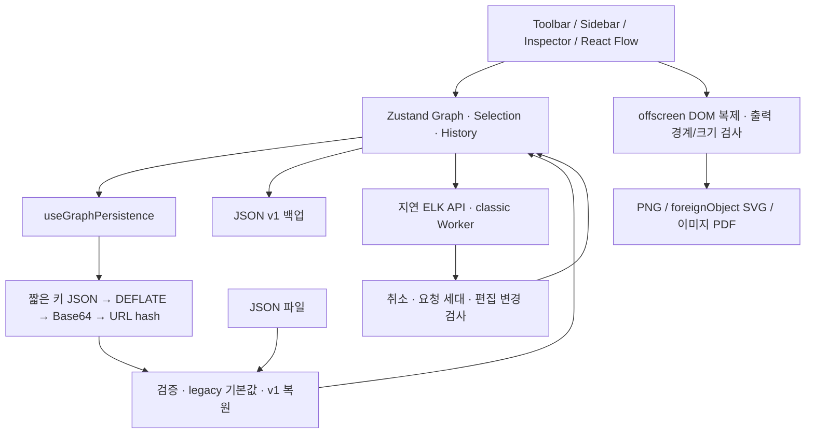

# 아키텍처와 데이터 흐름

브라우저 전용 React/TypeScript 편집기다. 계정·백엔드·서버 파일 저장소가 없으며 GitHub Pages는 정적 파일을 제공한다.

## 모듈 경계

| 모듈                                     | 책임                                                                 |
| ---------------------------------------- | -------------------------------------------------------------------- |
| App.tsx                                  | 초기 복원, 키보드, 파일/공유, 교체 확인, 레이아웃/출력 UI            |
| ArchitectureCanvas                       | React Flow 이벤트, 그룹 drop/상대 좌표, 접근 가능한 표시 파생 값     |
| useGraphStore                            | 그래프/선택, 80단계 Undo/Redo, 편집 트랜잭션, 정렬 적용/취소         |
| graphEditing / edgeUtils                 | 부모 순서·그룹/복제와 표시용 연결 속성                               |
| graphValidation / jsonUtils / urlUtils   | 입력 상한·참조 검증, v1/legacy 왕복, 기존 압축 형식                  |
| useGraphPersistence / persistenceChanges | UI 전용 변경 제외, 이동 종료 후400ms 저장, 외부 hash 교체 확인       |
| layoutGraph / layoutEngine               | 실제 크기/그룹 배치, ELK 지연 Worker, 실패 fallback와 취소/30초 제한 |
| exportDiagram / imagePdf                 | 원본 DOM 보존, 범위/배율/배경,16MP/8192px 제한, 출력 파일 생성       |
| useEditorTheme / useAssetPreferences     | localStorage의 테마/즐겨찾기/최근8종. 그래프와 독립                  |

## 데이터 계약

URL은 `{v:1,n,e}`, JSON 백업은 `{version:1,nodes,edges}`다. 버전 생략은 legacy로 읽는다. URL의 짧은 키와 DEFLATE/Base64 치환은 유지한다. UI 선택/viewport/테마/즐겨찾기는 공유 데이터에 넣지 않는다. 노드 크기/parentId/메모와 연결 스타일·라벨·방향·핸들은 저장한다. ELK 경로/접근 이름 등 파생 값은 복원 시 계산한다.

입력 실패는 현재 그래프를 교체하지 않는다. 성공한 교체도 확인과 Undo를 제공한다. 비동기 import 중 편집 또는 오래된 정렬 응답은 현재 작업을 덮어쓰지 않는다. Worker 취소는 계산 프로세스를 종료하며 출력 닫기는 결과만 버린다.

URL은 영구 백업이 아니다. 서버에 다이어그램을 전송하지 않지만 주소 복사/공유·브라우저 기록을 통해 데이터가 전달될 수 있다. 외부 링크로 떠나는 경우 hash가 HTTP 요청에 포함되는 것과는 구분해야 한다. 중요한 작업은 JSON으로 백업한다.

## 성능과 한계

노드/연결 참조 보존과 Map 조회, memo/selector, 저장 빈도 제한을 적용했다. 정렬은 처음 실행할 때 Worker를 요청한다. 200연결 초과 시 표시 애니메이션만 생략한다. 출력 CSS 목록은 템플릿 변경 시 함께 유지해야 한다.

[실측 결과](benchmarks/README.md)는10/50/100/300 chain/dense를 다루며 전체 PNG의 간헐적인 약7초 지연도 기록한다. JS heap은 native canvas/GPU/peak 메모리를 대표하지 않는다. SVG는 foreignObject, PDF는 한 페이지 이미지여서 모든 디자인 도구 호환/텍스트 검색을 지원하지 않는다.

핵심 결정과 호환성 영향은 [DECISIONS](DECISIONS.md), 현재 검증 범위는 [PROGRESS](PROGRESS.md)를 따른다.
