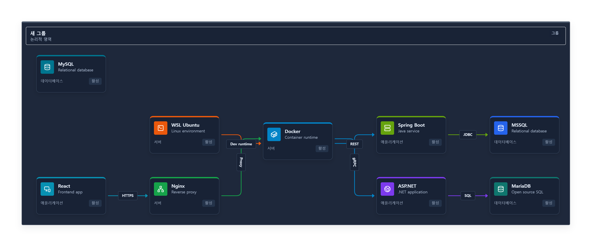

# Architecture Diagram Editor 소개

시스템·서버·데이터베이스·클라우드를 브라우저에서 배치하고 URL 또는 파일로 전달하는 아키텍처 편집기다. 계정이나 백엔드 없이 사용할 수 있다.

## 사용 예

팀 설계 초안, 서비스 연결 흐름 설명, VPC/DB/Application 영역 구분과 문서용 이미지 제작에 활용할 수 있다. 샘플을 불러와 이름/연결을 수정하고 자동 정렬한 뒤 공유 링크와 JSON 백업을 남긴다.

## 구현에서 다룬 문제

- React Flow/Zustand로 다중 선택·그룹 상대 좌표·복제 참조 재매핑·단일 Undo 트랜잭션을 유지했다.
- URL 압축과 JSON v1/legacy 호환, 손상 입력/크기 제한, 비동기 복원 경합으로부터 현재 작업을 보호했다.
- ELK Worker를 지연 로드하고 취소/오류/timeout 후 재시작을 구현했다.
- DOM을 복제하여 전체/현재 범위 PNG/SVG/PDF를 만들고 원본 편집 상태와 출력 메모리 할당 한도를 보존했다.
- 대량 그래프를 실제 측정한 뒤 참조/selector/CSS 복사 비용을 줄였다. 성능 개선 수치와 악화 사례를 함께 공개했다.

## 근거와 범위

[성능 보고서](benchmarks/README.md), [아키텍처](ARCHITECTURE.md), [기술 결정](DECISIONS.md), [현재 검증 상태](PROGRESS.md)를 제공한다. 300노드 60fps나 완전한 WCAG 준수, 다른 브라우저 검증을 주장하지 않는다. SVG foreignObject와 이미지 PDF의 제한, 간헐적인 전체 PNG 지연은 공개된 후속 과제다.

실행: https://heoseongbin.github.io/Architecture-/ · 소스: https://github.com/HeoSeongbin/Architecture-
